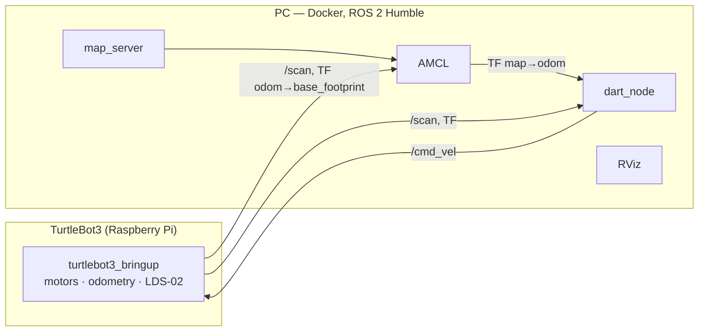
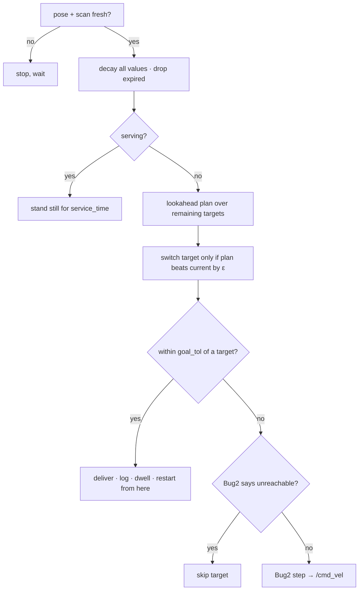

# DART — Decision-Adaptive Reward Targeting

Online target selection and reactive navigation for a **single mobile robot
delivering many tasks whose value decays over time** (perishable rewards, e.g.
food that cools down or melts). Runs on a **TurtleBot3 Burger** with
**ROS 2 Humble**.

- **Decision:** a lookahead planner picks the visiting order that maximises the
  total value collected, re-planned continuously as values decay.
- **Navigation:** a reactive, DART-modified **Bug2** (no A\*, no global path
  planner). The map is used only for localization (AMCL) and goal coordinates.

> **Full documentation:** [`docs/`](docs/README.md) — concept, architecture,
> decision and navigation in depth, localization and safety, development
> history with evidence, experiments and results, operations, limitations.

---

## Contents

1. [Repository layout](#1-repository-layout)
2. [System architecture](#2-system-architecture)
3. [Decision layer](#3-decision-layer)
4. [Navigation layer (DART-modified Bug2)](#4-navigation-layer-dart-modified-bug2)
5. [Localization and safety](#5-localization-and-safety)
6. [Getting started](#6-getting-started)
7. [Configuration](#7-configuration)
8. [Outputs and debugging](#8-outputs-and-debugging)
9. [Tools](#9-tools)
10. [Headless simulator](#10-headless-simulator)
11. [Results so far](#11-results-so-far)
12. [Known limitations](#12-known-limitations)

---

## 1. Repository layout

```
dart/                 pure-Python core (pip package "dart", ROS-agnostic)
  decay.py              value decay + expiry
  planner.py            lookahead ordering (full permutation / 2-opt)  <- drives the robot
  scoring.py            Target / RobotState, greedy Net score
  decider.py            greedy argmax + hysteresis (simulator baseline only)
  localization/         PoseSource interface + SimPoseSource
  sim/                  headless DART-vs-nearest-first comparison
ros/dart_ros/         ROS 2 Humble package (ament_python)
  dart_ros/dart_node.py   the online loop: decay -> plan -> switch -> deliver -> navigate
  dart_ros/navigator.py   Bug2 (pure-pursuit boundary following)
  dart_ros/pose_source.py odom / AMCL pose sources
  dart_ros/config.py      YAML loader (include:, half_life, food types)
  dart_ros/path_map.py    end-of-run path map PNG
  config/                 common.yaml + per-mode files (sim, sim_amcl, real, real_small, ...)
  launch/                 sim.launch.py, sim_amcl.launch.py, real.launch.py
  rviz/ worlds/
docker/               Humble container (Dockerfile, run.sh, SETUP.md)
tools/                map2world.py, rotate_map.py, analysis/ (rosbag + simulator tools)
docs/                 full documentation
maps/                 SLAM maps (map_small = default for the real robot)
```

The design spec `DART_concept.md` is kept locally and is not part of the repo.

---

## 2. System architecture

All computation runs on the PC inside the Docker container. The robot's
Raspberry Pi only runs `turtlebot3_bringup`.



Each cycle of `dart_node` (20 Hz):



---

## 3. Decision layer

### Value model

Each target $i$ has a position, a base value $v_i^0$ and a decay rate
$\lambda_i = \ln 2 / t_{1/2,i}$. Values decay continuously (wall-clock time):

$$v_i(t+\Delta t) = v_i(t)\,e^{-\lambda_i \Delta t}$$

A target expires (is dropped) once $v_i < 5\%$ of $v_i^0$.

### Lookahead planner (`dart/planner.py`)

For a candidate visiting order $(k_1, k_2, \dots)$ the planner simulates the
cumulative arrival times with straight-line travel and a fixed service stop:

$$t_{k_j} = t_{k_{j-1}} + \frac{\lVert p_{k_j} - p_{k_{j-1}}\rVert}{s} + t_{\text{service}}
\qquad
\text{total} = \sum_j v_{k_j}\,e^{-\lambda_{k_j} t_{k_j}}$$

(targets that would expire before arrival count 0). It returns the order with
the highest total: **full permutation** for ≤ 7 targets, **nearest-neighbour +
2-opt** above that. The plan is recomputed every cycle.

### Commitment and switching (`dart_node`)

- With no current target, the first target of the plan is committed.
- The current target is **switched** only if
  $\text{total(plan)} > (1+\varepsilon)\cdot\text{total(current first)}$,
  $\varepsilon = 0.15$ (hysteresis against flip-flopping). Switching is allowed
  at any time, also while going round an obstacle; the m-line is redrawn.

### Delivery

- Reaching the current target (within `goal_tol`) delivers it: the robot stops
  for `service_time` and the next target starts from that spot (new m-line).
- **Deliver on the way:** passing within `goal_tol` of *another* target also
  delivers it, then the current target is restarted from there.
- If Bug2 reports a target unreachable, it is skipped and logged.

---

## 4. Navigation layer (DART-modified Bug2)

`ros/dart_ros/dart_ros/navigator.py`. Distances are from the LiDAR; Burger
radius 0.105 m; values shown are those of `real_small.yaml`.

| Step | Rule |
|---|---|
| Go to goal | $w = 1.5\,e_\theta$, $v = v_{max}\cos e_\theta$; no forward motion if the swept corridor is blocked |
| **Hit** | an obstacle within ±15° of the goal direction closer than `safe_distance` (0.28 m) **and** closer than the goal — or facing the goal with the swept corridor blocked |
| Side choice | go round on the more open side (Bug2: "either left or right"), chosen at each hit |
| Boundary following | **pure pursuit** around the tracked boundary point $P$: carrot $= P + d\,\hat n + L\,\hat t$, $d$ = `wall_offset` (0.20 m), $L$ = 0.15 m, at 80 % speed; the point is tracked scan-to-scan in the robot frame; points > 120° behind are ignored |
| Merging | another obstacle closer than 0.19 m ahead joins the boundary only if the gap to it is narrower than the robot can pass (0.30 m) |
| Swept corridor | anything < 0.19 m ahead and < 0.14 m off the centre line: if across the path or on the obstacle side it is the next face (follow it, turn away from the obstacle side); if wholly on the free side, turn away from it and keep the boundary |
| **Leave** | re-crossed the m-line **and** ≥ 5 cm nearer the goal than at the hit **and** the way to the goal is free |
| **Unreachable** | went > 0.30 m away from the hit point and came back within 0.15 m |

---

## 5. Localization and safety

- **AMCL** on a SLAM map: corrections every 0.1 m / 0.1 rad, resampling every
  2 updates, `likelihood_field_prob` with **beam skipping** (robust to
  obstacles that are not in the map), LDS-02 range 0.16–3.5 m.
- **Pose for control:** live odometry composed with a low-pass filtered AMCL
  correction (τ = 0.7 s); corrections > 0.3 m / 20° (re-localization) apply at
  once. This removes the steering jitter caused by AMCL jumps.
- **Stale-data stop:** the robot stops if pose or scan is older than 1 s (or
  AMCL silent for 3 s) and resumes automatically.
- **Clean shutdown:** Ctrl+C stops the node within ~0.5 s and publishes a zero
  `/cmd_vel` five times.
- Angular speed is capped at 1.2 rad/s on the real robot so AMCL keeps up.

---

## 6. Getting started

### 6.1 Workspace

colcon does not look inside a package folder, so the ROS package and the
helper folders are linked next to the clone:

```bash
mkdir -p ~/DART_ws/src && cd ~/DART_ws/src
git clone https://github.com/pruk17/DART.git
ln -s DART/ros/dart_ros dart_ros
cd ~/DART_ws
ln -s src/DART/docker docker && ln -s src/DART/tools tools && ln -s src/DART/maps maps
```

### 6.2 Docker (host Ubuntu 24.04 → Humble container)

```bash
./docker/run.sh build     # once
./docker/run.sh up        # shell in the container (/ws = ~/DART_ws)
./docker/run.sh exec      # more shells
```

Inside the container (the `dart` pip package is installed automatically):

```bash
colcon build --symlink-install && source install/setup.bash
```

With `--symlink-install`, edits to Python, YAML and launch files take effect
without rebuilding; only **new** files need another `colcon build`.

### 6.3 Simulation (Gazebo)

```bash
ros2 launch dart_ros sim.launch.py        # cube world, odometry pose, config/sim.yaml
ros2 launch dart_ros sim_amcl.launch.py   # world generated from maps/map.yaml, AMCL
```

### 6.4 Real robot

On the robot: `ros2 launch turtlebot3_bringup robot.launch.py`. On the PC,
two terminals (defaults: `maps/map_small.yaml`, `config/real_small.yaml`,
start pose x=0.19, y=−0.78, yaw=0):

```bash
ros2 launch dart_ros real.launch.py                                                    # localization + RViz
```

Check the pose in RViz (LiDAR points on the walls; use *2D Pose Estimate* if
needed), then:

```bash
ros2 launch dart_ros real.launch.py localization:=false rviz:=false start_dart:=true   # DART
```

Other map / config / start pose: `map:=… config_file:=… x0:=… y0:=… yaw0:=…`.
Make sure no other node (e.g. `teleop_keyboard`) publishes `/cmd_vel`.

### 6.5 Recording a run

```bash
mkdir -p /ws/bags
ros2 bag record -o /ws/bags/run_$(date +%H%M%S) /scan /tf /tf_static /odom /cmd_vel /rosout
```

---

## 7. Configuration

Configs are YAML files in `ros/dart_ros/config/`. A file may `include:` another
and override any value; `common.yaml` holds the shared tuning.

| Key | Default (common) | Real-robot value | Meaning |
|---|---|---|---|
| `robot.speed` | 0.20 m/s | 0.20 | nominal speed (also used by the planner) |
| `robot.goal_tol` | 0.15 m | 0.15 | a target counts as reached within this |
| `robot.safe_distance` | 0.35 m | 0.28 (`real_small`) | Bug2 hit distance |
| `robot.wall_offset` | 0.30 m | 0.20 (`real_small`) | distance kept while following a boundary |
| `robot.max_ang` | 2.84 rad/s | 1.2 (`real`) | angular speed cap |
| `robot.wall_follow_speed` | 0.8 | 0.8 | speed fraction while following a boundary |
| `decider.epsilon` | 0.15 | 0.15 | switching hysteresis |
| `decider.replan_rate` | 20 Hz | 20 | loop / re-plan rate |
| `expire_threshold` | 0.05 | 0.05 | drop a target below this fraction of its base value |
| `service_time` | 3.0 s | 3.0 | stop at each delivery |
| `deadline` | 60 s | 60 | reported in the run log |

**Food types** (`task_types` in `common.yaml`; a target uses `type: <name>` and
may override `v` / `half_life` itself):

| type | v | half-life | left after 60 s |
|---|---:|---:|---:|
| `ice_cream` | 4 | 30 s | 25 % |
| `fries` | 3 | 35 s | 30 % |
| `hot_soup` | 4 | 40 s | 35 % |
| `main_dish` | 5 | 60 s | 50 % |
| `cold_drink` | 2 | 95 s | 65 % |
| `salad` | 3 | 185 s | 80 % |
| `default` | 1 | 60 s | 50 % |

**Targets** in `real_small.yaml` (map frame of `map_small`, 0.18 m from both
walls of their corner; RViz view):

```yaml
targets:
  - { id: m1, position: [0.97, -0.93], type: ice_cream }   # bottom-right
  - { id: m2, position: [0.97,  0.01], type: main_dish }   # top-right
  - { id: m3, position: [0.03,  0.01], type: hot_soup  }   # top-left
  - { id: m4, position: [0.03, -0.93], type: fries     }   # bottom-left (start corner)
```

`position` is `[x, y]` in metres in the map frame; in RViz `x` grows to the
right and `y` upwards.

---

## 8. Outputs and debugging

- **Debug block** (once per second): pose, mode (`GO_TO_GOAL` / `WALL_FOLLOW`),
  command, front clearance, current plan, data ages, every target's value and
  distance.
- **Run log** `dart_logs/dart_run_<time>.log`: events (reached, reached on the
  way, switch, expired, unreachable, stale-data stops) and a summary
  (finish time vs deadline, delivered, collected value, average quality).
- **Path map** `dart_logs/dart_run_<time>.png`: trajectory over the map,
  delivery order and quality of each target.
- Only the newest 3 runs (log + PNG) are kept.

---

## 9. Tools

From the repo root:

```bash
python3 tools/map2world.py maps/map.yaml ros/dart_ros/worlds/dart_room.world   # SLAM map -> Gazebo world
python3 tools/rotate_map.py maps/map_test.yaml maps/map_test_0deg 11.5        # rotate a map (axis-align walls)
```

---

## 10. Headless simulator

The pure-Python package also contains a headless comparison of the **greedy**
DART score against nearest-first (it does not use the lookahead planner):

```bash
python -m dart.sim.run_comparison --targets 20 --seed 0     # or: dart-sim
```

Greedy score used there:

$$\text{Net}_i = v_i e^{-\lambda_i t_i} - \sum_{j\ne i} v_j\left(1-e^{-\lambda_j t_i}\right),\qquad t_i = d_i/s$$

| targets | DART avg value | nearest-first avg | DART win rate |
|---:|---:|---:|---:|
| 10 | 8.71 | 8.29 | 80 % |
| 20 | 15.19 | 13.97 | 60 % |
| 30 | 18.49 | 18.52 | 40 % |
| 40 | 24.21 | 22.89 | 70 % |

(10 seeds per configuration, varied base values.)

---

## 11. Results so far

Real TurtleBot3 Burger, 1.3 × 1.3 m test room:

- **No obstacles:** all targets delivered in every run, ~20–28 s for 3 targets.
- **Static obstacles:** all targets delivered; tight boundary following
  (median hug distance 0.20–0.25 m for a 0.20 m setting), no wall hopping.
- **Obstacles moved during the run:** all targets delivered when a path
  existed; long detours can exceed the 60 s deadline.
- Simulation (24 obstacle cases on `map_small`): 22 reached, 2 judged
  unreachable; 18/18 without obstacles; no collisions.

---

## 12. Known limitations

- The planner estimates travel time from **straight-line distance**, so it does
  not know when the current target needs a long detour.
- Bug2 can judge a target **unreachable** when it lies in a pocket whose mouth
  is only slightly wider than the robot (≈ 0.4 m).
- There is no general loop detector: following an obstacle that never crosses
  the m-line nor returns to the hit point could circle for a long time.
- The LDS-02 sees nothing closer than 0.16 m; an obstacle placed against the
  robot at start can be missed.
- Hardware: `turtlebot3_node` stops publishing odometry when the battery is
  low; the node then stops the robot (stale data) until the robot is restarted.
