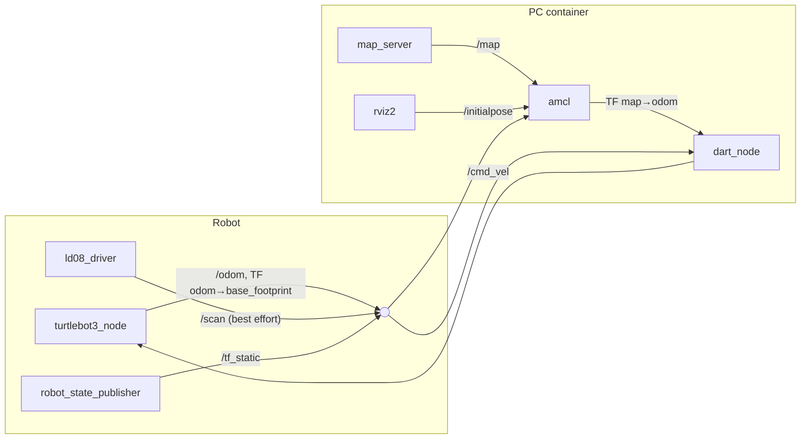
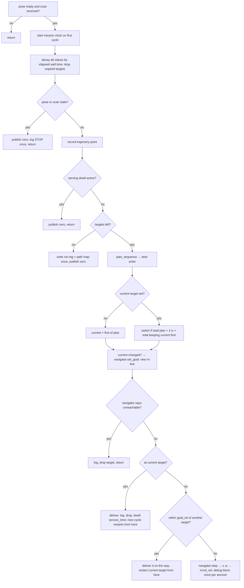

# 2. Architecture

## 2.1 Hardware and software split

| Where | Runs | Why |
|---|---|---|
| TurtleBot3 Burger (Raspberry Pi, Ubuntu 22.04, ROS 2 Humble) | `turtlebot3_bringup` only: `turtlebot3_node` (OpenCR motors, wheel odometry, IMU), `ld08_driver` (LDS-02 LiDAR), `robot_state_publisher` | keep the Pi's load minimal |
| PC (Ubuntu 24.04 host, Docker container with Ubuntu 22.04 + ROS 2 Humble) | `map_server`, `amcl`, `lifecycle_manager`, `rviz2`, `dart_node` | all computation; ROS 2 distribution must match the robot, and Humble is not available natively on 24.04 |

Robot and PC talk over Wi-Fi with DDS (Fast DDS, `ROS_DOMAIN_ID=30`); the
container uses `--network host`.

Robot hardware facts used throughout:

| Item | Value |
|---|---|
| Footprint radius | ≈ 0.105 m |
| Max speed | 0.22 m/s linear, 2.84 rad/s angular |
| LiDAR | LDS-02, ~10 Hz, ~232 beams/scan (≈1.55°), **minimum range 0.16 m** (closer objects return 0) |
| LiDAR mounting | `base_scan` 0.032 m behind `base_footprint` |
| `/cmd_vel` type (Humble) | `geometry_msgs/Twist` |

## 2.2 ROS graph



- `dart_node` subscribes to `/scan` with the **sensor-data (best-effort) QoS**;
  a reliable subscription receives nothing from the LDS driver.
- The pose is read from **TF** (`map→odom` from AMCL composed with
  `odom→base_footprint` from odometry), not from `/amcl_pose`, because
  `/amcl_pose` is only published when the robot moves — a stationary robot
  would never get its first pose.

## 2.3 Code layout

```
dart/                         pure Python, no ROS
  scoring.py                    Target, RobotState, distance, value_remaining, greedy Net
  decay.py                      decay_basket(): decay + expiry; snapshot_initial_values()
  planner.py                    simulate_sequence, plan_full_permutation, plan_two_opt, plan_sequence
  decider.py                    greedy argmax + hysteresis (simulator baseline)
  localization/pose_source.py   PoseSource interface, SimPoseSource
  sim/world.py, run_comparison.py   headless DART-vs-nearest-first comparison
ros/dart_ros/                 ROS 2 package (ament_python)
  dart_ros/dart_node.py         the online loop
  dart_ros/navigator.py         Bug2 navigator (ReactiveNavigatorROS)
  dart_ros/pose_source.py       OdomPoseSource, AmclPoseSource (smoothed)
  dart_ros/config.py            YAML loader
  dart_ros/path_map.py          end-of-run PNG
  config/*.yaml                 common.yaml + sim / sim_amcl / real / real_test / real_test_0deg / real_small
  launch/                       sim.launch.py, sim_amcl.launch.py, real.launch.py
  rviz/real.rviz                RViz layout (map, scan, particles, robot, TF, 2D Pose Estimate)
  worlds/                       dart_cubes.world, dart_room.world (generated from a map)
docker/                       Dockerfile, run.sh, SETUP.md
tools/                        map2world.py, rotate_map.py, analysis/
maps/                         map (2.2 m room), map_test (1.3 m room, tilted −11.5°),
                              map_test_0deg (rotated), map_small (1.3 m room, new SLAM; default)
```

The pure-Python package is shared by the simulator and the robot so both use
the same decay and planning code. It is installed with `pip install -e`
(classic `setup.py`, because the Humble container pins setuptools 59.6).

## 2.4 Launch files

| Launch | World / map | Pose source | Notes |
|---|---|---|---|
| `sim.launch.py` | Gazebo `dart_cubes.world` (open ground, 4 cubes, 7 pads) | `/odom` | config `sim.yaml`; DART starts after 8 s |
| `sim_amcl.launch.py` | Gazebo `dart_room.world` generated from `maps/map.yaml` | AMCL | spawn (1.75, −1.65); config `sim_amcl.yaml`; DART after 10 s |
| `real.launch.py` | real robot, `maps/map_small.yaml` | AMCL | switches `localization`, `rviz`, `start_dart`; start pose `x0 y0 yaw0` |

`real.launch.py` is used in two steps: first localization + RViz (check the
pose, use *2D Pose Estimate* if needed), then `start_dart:=true` with the other
two switched off.

## 2.5 The 20 Hz cycle (`DartNode._tick`)



### Node parameters

| Parameter | Default | Meaning |
|---|---|---|
| `config_file` | required | YAML config |
| `pose_source` | `odom` | `odom` or `amcl` |
| `cmd_vel_topic`, `scan_topic` | `/cmd_vel`, `/scan` | topics |
| `use_twist_stamped` | false | `TwistStamped` for Jazzy |
| `debug`, `debug_period` | true, 1.0 s | periodic state block |
| `log_dir`, `keep_logs` | `./dart_logs`, 3 | run logs kept |
| `map_yaml` | — | map drawn under the path map |
| `stale_timeout` | 1.0 s | stop if pose/scan older |
| `pose_smoothing_tau` | 0.7 s | AMCL correction low-pass (0 = off) |

## 2.6 Configuration loading (`config.py`)

- A YAML file may contain `include: other.yaml` (path relative to the file).
  The included file is loaded first and **deep-merged**: nested dictionaries
  merge, other keys (e.g. the `targets` list) are replaced.
  Chain used on the robot: `real_small.yaml → real.yaml → common.yaml`.
- Decay can be given as `half_life` (seconds; preferred) or `lam`;
  `half_life` wins. `λ = ln 2 / half_life`.
- Each target may name a `type` from `task_types`; its own `v` / `half_life`
  override the type. An unknown type silently falls back to `default`.
- Only **new** files need a `colcon build`; with `--symlink-install`, edits to
  existing YAML, launch and Python files take effect on the next start.

## 2.7 Docker environment

`docker/Dockerfile` starts from `osrf/ros:humble-desktop` and adds colcon,
TurtleBot3 (incl. Gazebo simulation), Navigation2 and gazebo_ros. It sets
software rendering (`LIBGL_ALWAYS_SOFTWARE=1`), an empty Gazebo model database
(avoids a hang while spawning) and the model path (otherwise the robot falls
through the ground). Every shell sources ROS and the workspace and installs
the `dart` package if missing. `run.sh` wraps `build / up / exec / down`; see
[docker/SETUP.md](../docker/SETUP.md).

Workspace layout: colcon does not search inside a package directory, so the
repository is cloned to `src/DART` and `src/dart_ros` is a symlink to
`DART/ros/dart_ros`; `docker`, `tools`, `maps` are symlinked at the workspace
root (paths such as `/ws/maps/map_small.yaml` are used by the launch files).
